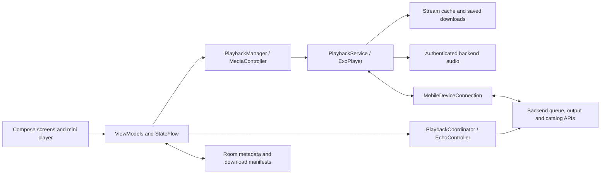

# Music Box Android architecture

Verified against `feat/alexa-backend` at `364ab96ad9d7d2eb75f7c898399fb252cc84e71b` (2.4.54 / 106), 2026-10-25. [History and PR provenance](CHANGELOG.md) · [Backend architecture](https://github.com/arookiecoder-ip/youtube-music-alexa-skill/blob/master/ARCHITECTURE.md).

## System boundary

Music Box is a native Kotlin/Compose client for a single-owner, multiple-output system. The backend owns shared output selection and queue revisions; the device selected as renderer owns audible playback. A controller phone can display/control browser or Echo playback without rendering that audio locally. The backend now gives API and browser services independent bridge networking, with a private gateway that prefers VPN egress and falls back to direct networking. The Android client uses the same HTTPS server origin and does not require an Android VPN service.

The backend serves browser and Echo playback too. Android is not the authority for another device's playback state, and successful command submission alone is not proof that a remote device is audible.

## Source map

Paths below are relative to `app/src/main/java/in/synthora/musicbox/`.

| Component | Responsibility |
| --- | --- |
| `JukeApplication.kt`, `MainActivity.kt` | Application startup, lifecycle visibility, navigation and player presentation. |
| `viewmodels/MusicViewModel.kt` | Output-aware UI projection, selection intent, radio, handoff, queue publication, lyrics and palette coordination. |
| `viewmodels/SearchViewModel.kt` | Suggestions/results, artist catalog/video pagination, subscription state and cancellation. |
| `services/PlaybackManager.kt`, `services/QueueManager.kt` | MediaController binding, renderer queue operations and application queue metadata. |
| `services/PlaybackService.kt` | MediaLibraryService, ExoPlayer, session commands, recovery, current/next preloading and resumption. |
| `services/PlaybackCoordinator.kt`, `services/EchoController.kt` | One application-owned remote controller shared by UI and notification consumers. |
| `services/RemotePlaybackService.kt` | Remote MediaSession/notification presentation and bounded track-boundary previews. |
| `services/MobileDeviceConnection.kt`, `services/PhonePlaybackOwnership.kt` | Presence, acknowledged commands, visibility and phone ownership/lease checks. |
| `services/SharedQueue.kt`, `services/PhoneQueuePublication.kt` | Queue identity/revision and atomic phone publications. |
| `network/Backend.kt`, `network/AudioCredentials.kt` | HTTPS account sessions, origin-bound credentials, HTTP errors and scoped audio tokens. |
| `services/PlaybackDataSources.kt` and audio data-source wrappers | Credential injection, response validation, cache reads and network fallback. |
| `services/UpcomingAudioPreloader.kt`, `services/CurrentAudioDownloadGuard.kt` | Bounded current/next-five work, retention, retry and demand-download lifetime. |
| `database/MusicDatabase.kt`, `database/DownloadManifestDatabase.kt` | Music metadata and separate persistent download/collection manifests. |
| `services/PlaybackClock.kt`, `network/LyricsApi.kt`, `utils/LrcParser.kt` | Subscriber-driven progress clock, lyric lookup and timed lyric parsing. |
| `network/ArtworkRepository.kt`, `ui/components/AmbientBackdrop.kt` | Shared artwork resolution and smoothly animated background drawing. |
| `services/PlaybackDiagnostics.kt` | Bounded timing/error/event evidence for recovery and debugging. |

## Playback state and selection

`MusicViewModel` combines phone state, remote state, favorites, lyrics, artwork colors, output switching and pending transport intent. It derives resolving/buffering/playing/paused/switching/failed/idle presentation without substituting UI optimism for renderer confirmation.

An explicit queue selection records the requested track/occurrence and invokes the authorized renderer path even when the previous song was paused. A failed B request remains B with an error and Retry; late A cursor/metadata updates cannot silently select A again. New selection, transport navigation and sign-out cancel superseded preparation and prevent late jobs from clearing a newer request.

Queue rows use canonical occurrence metadata; a lagging now-playing snapshot cannot put A's name/art into B's row. Stable pointer handlers resolve the entry being operated on instead of retaining a stale index/callback while playback or edit flags change. Repeated video IDs still need distinct queue occurrence identities.

Radio uses the currently selected track as its seed, refreshes the mix on each explicit request and rejects stale responses if playback moves. Collection playback instead retains the collection and incrementally backfills large playlists; it does not wait for every page before the first song can start.

## Ownership and handoff

Output snapshots carry an epoch, output revision, receiver identity/token and a playback revision. Revisions compare within the corresponding generation; an older decode or response cannot become authoritative after a command, output change or sign-out.

For a handoff:

1. Capture source queue occurrence, cursor and play/pause intent.
2. Request/validate destination ownership and prepare its renderer while keeping stale work fenced.
3. Pause the actual source renderer and acknowledge with the expected ownership token and final cursor.
4. Complete destination playback only after authorization and preparation remain current; reconcile confirmation into the UI.
5. Cancel/roll back only the still-current transfer on failure. An expired acknowledgment cannot overwrite a newer owner or position.

Phone leases and device presence are separate from cosmetic progress updates. Lease expiry prevents unsafe online continuation, while available local audio follows the offline recovery policy. Reconnection verifies current server ownership before online playback resumes.

An offline Echo cannot remain an invisible selected output indefinitely. Idle fallback selects an eligible foreground device without automatically reviving saved audio. Closed-device failover is server-validated, preserves cursor/intent and distinguishes a browser refresh's reconnect grace from a genuine close. Partitioned/offline devices cannot be guaranteed mutually exclusive until they can communicate again.

## Audio pipeline and storage

The server's progressive `/audio/` endpoint supplies phone/browser audio; `/proxy/` is the Echo path and has different playback-confirmation effects. A phone audio read must never claim Echo playback. `wait=1` on the current backend is a compatibility argument, not a requirement to finish downloading a song before serving it.

Media3 reads through the shared data-source pipeline. Backend audio credentials are added as headers only for validated backend audio origins/paths; they are not carried in media URIs or forwarded indiscriminately to other hosts. MIME/byte-range validation rejects HTML/error bodies masquerading as music. Bounded retries can repair bad/incomplete cached audio, reopen network sockets or use a completed local representation, while preserving song, generation and requested offset.

| Store | Owner and retention |
| --- | --- |
| Server current audio | Backend, one temporary current-track byte file. Neither an Android download library nor a server song archive. |
| Phone stream cache | ExoPlayer cache, default 256 MiB, setting range 128–1024 MiB. Retained set is current plus next five URLs; old temporary entries are pruned as this set changes. |
| Saved downloads | Local persistent files with independently persisted manifest/collection membership. Queue-cache eviction does not delete them. |
| Room/music data | Track metadata, lyrics and local-library state; separate from download manifests. |
| Home/artwork/lyrics caches | Bounded or TTL-based metadata/image caches, not the removed server audio cache. |

The selected song's demand writer gets priority. Normal speculative policy permits five complete next streams. Offline/buffering/metered opt-out, battery saver, severe thermal pressure or low battery suspend speculation; moderate thermal pressure permits one. Current demand handling remains independent. Budgets, unavailable sources and user settings mean five *eligible* next songs, not a guarantee that six complete files always exist.

The retention scan is not restarted for an unchanged key set. Preloader completion can start the lazy tail immediately instead of waiting for maintenance. Explicit downloads retain validation, progress, cancellation and restart state; the badge captures nullable progress safely across deferred Compose semantics reads.

## Recovery, calls and lifecycle

Service recovery jobs and delayed resumes are fenced by media identity, play intent and ownership. Explicit Pause/Stop, a new selection, handoff or sign-out cancels obsolete automatic resumes. A disconnected MediaController can reconnect; a process restart restores metadata and a saved cursor without inventing an active lease or automatically starting a stale queue.

`CallPlaybackGuard` records call-held intent, including focus loss that arrives before the modem's mode change. Mode/focus callbacks wake checks immediately; 500 ms checks cover active interruption recovery, with a 5-second ordinary fallback. Repeated call modes cannot replace the original resume snapshot. Hang-up resumes only a still-valid selection/owner; explicit Pause prevents it. Explicit Play during a call is a user override, with normal focus handling restored on exit.

Network retry, call-held notification retention and Android foreground-service authorization are distinct concerns. The ordinary music notification remains available when needed; the retired idle “Available for playback” notification/service is not revived just to advertise an unused device. OEM/carrier/Bluetooth behavior still requires physical-device validation.

## Remote observation and rendering cost

`PlaybackCoordinator` shares one `EchoController` between active consumers. `MobileDeviceConnection` keeps acknowledged commands and ownership live using negotiated presence waits up to eight seconds, waking immediately on changes. Presence expiration is not extended merely because a long wait completed.

| Remote observer condition | Base state-read behavior |
| --- | --- |
| Foreground, healthy live presence, stable state | Change events wake a read; 5-second backup poll. |
| Foreground without live presence, or pending processing | 500 ms fallback. |
| Background processing | 1 second. |
| Background playing | 10 seconds. |
| Background paused | 30 seconds. |
| Failures | Exponential backoff, capped at 60 seconds; presence events do not bypass that delay. |

This is distinct from the mandatory phone ownership lease and from the web client's polling policy. Long-poll presence is not an always-open audio response or a permanent SSE subscription.

The small `PlaybackClock` samples position for subscribed progress/lyric consumers (default 300 ms). It carries no queue/artwork payload and stops when unsubscribed. Queue preparation and artwork do not rebuild on every progress tick. Ambient brushes are cached and blend directly over the base instead of using an extra full-screen offscreen mask; per-song color animation remains enabled. No new frame-rate cap was introduced.

## Search, lyrics and presentation

Search suggestions are debounced, JSON-quoted and fenced against stale responses/failures. Full search and YouTube-link playback happen on submission. Exact title/artist matching preserves Unicode vowel marks and remix/live qualifiers, merges fallback result categories and prefers a valid matching audio counterpart without replacing it with an unrelated song.

The first Search navigation emits a focus request. The header establishes Compose focus without an indefinite window-focus wait, retries IME activation after the input connection exists, and retains a live input session across navigation re-taps. Closing/submitting cancels pending shows; old-field cleanup cannot hide a replacement field's keyboard.

`LyricsApi` uses the official `https://lrclib.net/api/search` query contract, metadata cleanup, bounded/rate-limited lookup and timed-result validation. Caption/YouTube Music fallbacks remain; unavailable timestamps mean plain lyrics. `LrcParser` supports multiple/offset/whole/fractional timestamps and malformed-input bounds. Both players share the playback clock and parser, including pause, backward seek and before-first-line behavior. Romanization uses the same LRC timestamp grammar, preserves repeated timestamps/offsets and rejects cached romanizations whose timing differs from the original. A delayed old-track lookup cannot overwrite a new song or erase newer timed lyrics.

Artist portraits load only while the picker is open. Artist music-video songs use a five-row preview and a separate paginated `ArtistSongsScreen` mode. Artist changes cancel/fence pagination. Optional artist playlists, featured-on collections and additional provider shelves retain their item kinds; empty shelves are omitted. Home uses the expanded backend feed without discarding same-title or single-item shelves. Expanding the description does not resize the banner. Scrolling sets a black status-bar fill and returning to the top removes it; that is the app's status area, not control over Android's expanded notification shade.

## Authentication, build and diagnostics

The account client uses an owner session scoped to the configured HTTPS origin; optional TOTP stays in that login flow. `ALEXA_API_KEY` is empty in current BuildConfig. Audio-only tokens are issued through `/api/app/audio-token/` (two hours for playback, 24 hours for system downloads), checked against live sessions and kept separate from queue/account mutation permissions. Historical skill/global-key compatibility remains on the backend for rollout.

Build identity is `in.synthora.musicbox`, version 2.4.54 / 106, compile/target SDK 36, minimum SDK 26. The historical package rename means earlier `com.example.juke` APKs are not the same Android application. Signing identity must also match for updates. The verified debug certificate is pinned in [.github/signing/debug-certificate.sha256](.github/signing/debug-certificate.sha256).

Use [Android Feature Build](.github/workflows/android-feature.yml) on this branch for update-compatible debug APKs, leaving `stable_release=false`. [Android CI](.github/workflows/android.yml) builds review APKs and JVM results. Keep Android compilation in GitHub Actions for this server deployment. The historical release/optimized variants do not turn a current debug artifact into a published stable release.

The merged manifest excludes microphone permission and MainActivity has no microphone permission prompt. Waveform-based playback diagnostics remain optional when unavailable. Queue sheets and inactive rows use the shared dock surface; playlist-name dialogs trim names, reject blanks, support IME submission and fence duplicate submissions. Delete dialogs require explicit confirmation.

Diagnostics retain bounded timing aggregates, anonymous source IDs, sanitized audio failure information and saved crashes. Aggregate server request time, HTTP acknowledgment, first byte, player readiness and audible playback are different metrics. Never derive phone battery percentages or physical Echo latency guarantees from JVM/emulator success.

## Validation snapshot and extension rules

At this source snapshot, [451 JVM tests](https://github.com/arookiecoder-ip/MusicBox-APP/actions/runs/40160853247) and [34 API 35 interaction tests](https://github.com/arookiecoder-ip/MusicBox-APP/actions/runs/40160853198) passed. They include queue intermediate frames/touch continuity, failed selection/retry, badge completion races, timed lyrics, real-service simulated calls, keyboard stress, blends, scroll-to-top and artist-video navigation. Optional broad tablet checks were not run in that build.

Physical Samsung Android 17 carrier/Bluetooth, frame timing and battery discharge were not certified. A single live Echo seek probe took about 90 ms for HTTP acknowledgment and 3.7 seconds to server confirmation; its longer boundary probe was interrupted by a separate Pause request. Deterministic backend boundary tests pass, but that probe did not prove an audible device transition.

When extending playback: preserve occurrence IDs and monotonic revisions; capture a generation before slow work; reject stale continuations after every suspension; separate optimistic UI from confirmed output; retain bounded queues/retries and error backoff; never let a metadata/audio read acquire another renderer's ownership. Add targeted race coverage instead of weakening these fences to make an interaction appear faster.
